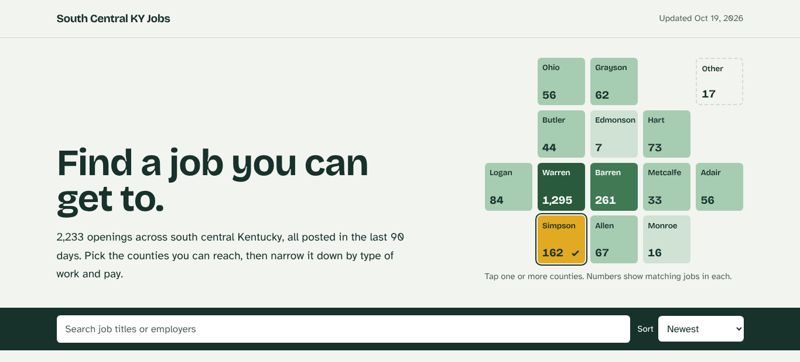
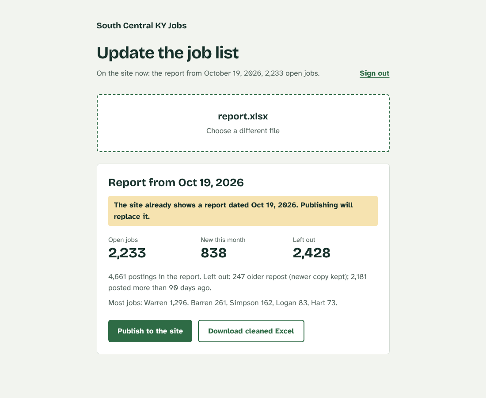
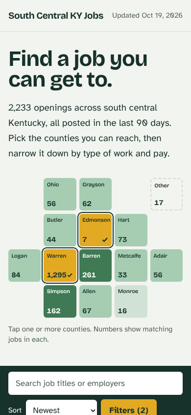

# South Central KY Jobs

A job board for south central Kentucky, built from the weekly open job report that
reentry case managers use to match people with work.

**Live site:** https://soky-jobs.vercel.app/



## The problem

The South Central Kentucky Reentry Council distributes a weekly JobsEQ export with
thousands of postings. It's a great resource but hard to use:

- Every job is marked "Active," including postings from 2016. Half the list is more
  than three months old, and many jobs are reposted several times.
- Locations are written about 650 different ways ("Bowling Green, Kentucky",
  "42104", "3075 Scottsville Rd, Bowling Green", GPS coordinates).
- There's no usable job category, and 75% of postings list no pay.

Case managers need to answer one question fast: *what real, current jobs are
within reach of this person?*

## What I built

- **A cleaning pipeline** that removes likely-filled jobs (older than 90 days, or
  older reposts of the same job), normalizes every location to a town and county,
  groups occupations into 22 plain-English categories, fixes ALL-CAPS titles,
  estimates hourly pay, and labels staffing agencies.
- **A job board** where you pick counties from a tile map, then filter by type of
  work, pay, and posting date. Filters live in the URL, so a case manager can text
  a client a link like `?county=Barren&type=Food%20Service`. Lists print as a
  compact table for clients without internet.
- **A password-protected admin page** (`/admin`) where a new report is uploaded,
  previewed, and published. Publishing commits the new data to GitHub, and Vercel
  redeploys automatically. It also produces a cleaned Excel workbook for anyone
  who prefers a spreadsheet.
- **A weekly link checker** that catches "ghost jobs" still listed on JobsEQ
  after the real posting closed. It checks every job on JobsEQ, then at the
  original posting (LinkedIn, employer career sites) each time a new report is
  published, hides the closed ones, and
  marks the rest "Confirmed open" with the date. Indeed blocks automated checks,
  so its jobs are checked from a real Chrome window on my own computer.



## Stack

Next.js 16 (App Router, Cache Components, Server Actions) · TypeScript ·
Tailwind CSS v4 · exceljs · GitHub Contents API · GitHub Actions ·
Playwright (playwright-core) · Vercel

## Technical decisions

- **Static site, data in git.** `src/data/jobs.json` is imported at build time,
  so the public site is fully static: no database, no API, no runtime cost.
  Every weekly update is a commit, which gives a free history of the job market.
  The JSON is written one job per line so each commit's diff shows exactly which
  jobs were added and removed.
- **Upload publishes through GitHub, not a database.** The admin page commits
  `jobs.json` with the GitHub Contents API, which triggers the same Vercel
  deploy as a manual push. Because the file is over 1 MB, the API is called with
  the `application/vnd.github.object` media type, which is the only way GitHub
  returns the file's `sha` at that size.
- **Cleaning rules live in one place.** `src/lib/report/` has no Next.js
  dependencies, so the same code runs in a Server Action on Vercel and in
  `npm run clean` on a laptop. It was ported from an earlier Python script and
  checked against it: identical output for all 2,233 jobs.
- **Location parsing takes the last town name in the text**, because street
  names are often town names ("3075 Scottsville Rd, Bowling Green").
- **Simple, signed sessions.** There's one admin, so the password lives in an
  environment variable and an HMAC-signed, httpOnly, SameSite=Strict cookie
  remembers the sign-in for 12 hours. Every Server Action re-checks the session
  itself, and comparisons use `timingSafeEqual`.
- **Preview, then publish.** Uploading only previews. Publishing re-cleans the
  file on the server rather than trusting data sent back from the browser, and
  warns if the report is older than the one already live.
- **Ghost-job checks are cautious.** A job is hidden only when a site clearly
  says it's closed (JobsEQ's "no longer available from the source", a 404,
  LinkedIn's "No longer accepting applications", or specific "expired" wording).
  "Open" requires the page to actually show the job's title. Everything else is
  "couldn't tell" and stays listed, because hiding a real job is worse than
  showing a dead one. Text inside `<script>` tags is ignored, since career sites
  often ship error messages in their JavaScript even on live jobs.
- **Polite crawling.** The checker identifies itself in its User-Agent, limits
  requests per site (LinkedIn: one at a time, 1.5 s apart), and stops asking a
  site after 8 refusals in a row. A failed check doesn't erase a clear answer
  from earlier in the week.
- **Two status files, two writers.** GitHub Actions writes
  `src/data/job-status.json` after each upload; the Indeed script on my PC writes
  `src/data/indeed-status.json`. Separate files mean the two never cause merge
  conflicts. The site combines them at build time.
- **The Indeed script never bypasses bot checks.** It drives the installed Chrome
  at a person's pace; if Indeed asks for human verification, it pauses until I
  complete it.
- **Cache Components gotcha:** the admin gate calls `connection()` first.
  Without it, Next prerenders the "is the password configured?" check at build
  time and bakes the answer into the page.

## Accessibility and testing

- Body text is set in Atkinson Hyperlegible (designed by the Braille Institute
  for low-vision readers) at a 17px base. All text and UI color pairs meet WCAG AA
  (4.5:1 or better).
- County tiles are real buttons with `aria-pressed` and labels like "Warren
  County, 1,295 jobs"; the selected state uses a checkmark, not just color.
- The result count is an `aria-live` region; the mobile filter drawer is a
  native `<dialog>` (focus trapping and Esc for free); visible focus everywhere;
  reduced motion respected.
- Tested with Playwright: desktop and mobile layouts, keyboard-only county
  selection, print view, and the full admin flow (wrong password, bad file,
  preview, Excel download, publish against a mock GitHub API, sign out,
  unauthenticated requests rejected).
- Link-check rules have unit tests (`npm test`) built from real JobsEQ and
  LinkedIn markup, including traps like error text hidden in JavaScript and
  harmless phrases such as "relocation is not available". The full checker and
  the Indeed script were run against fake sites, including a simulated outage
  and a human-verification pause.



## Setup

```bash
npm install
cp .env.example .env.local   # fill in values to test /admin locally
npm run dev                  # http://localhost:3000
```

### Deploying on Vercel

1. Import the GitHub repo into Vercel (defaults are fine).
2. Create a GitHub fine-grained token: Settings > Developer settings >
   Fine-grained tokens. Repository access: only this repo. Permissions:
   Contents, Read and write.
3. In Vercel, Project > Settings > Environment Variables, add `ADMIN_PASSWORD`,
   `SESSION_SECRET`, `GITHUB_TOKEN`, and `GITHUB_REPO` (see `.env.example`).
4. Redeploy so the variables take effect.

### Weekly update

**From the website:** go to `/admin`, sign in, choose the report, check the
preview, click **Publish to the site**. Live in about a minute.

**From your laptop:**

```bash
npm run clean -- ~/Downloads/South_Central_Open_Job_Report_10-26-2026.xlsx
git add src/data/jobs.json
git commit -m "Jobs report 10/26/2026"
git push
```

### Link checking

**Weekly (automatic):** GitHub Actions runs `.github/workflows/check-jobs.yml`
right after a new report is published from `/admin` (or pushed). It commits
`src/data/job-status.json`, and Vercel redeploys. To run it on demand:
GitHub → Actions → Check job links → Run workflow. Each run's page shows a table
of open / closed / couldn't-tell by source.

If Vercel doesn't redeploy after those commits, create a Deploy Hook in Vercel
(Project → Settings → Git → Deploy Hooks) and save its URL as the repo secret
`VERCEL_DEPLOY_HOOK`.

**Indeed (from your PC, after the weekly check finishes):**

```bash
git pull                   # get this week's check results
npm run check-indeed       # Chrome opens and works through the Indeed jobs
git add src/data/indeed-status.json
git commit -m "Indeed check"
git push
```

### Common changes

- **A town shows as "Unknown":** add it to `CITY_TO_COUNTY` in `src/lib/report/rules.ts`.
- **Change the 90-day cutoff or other rules:** `src/lib/report/rules.ts`.
- **Add a county to the map:** `MAP_COUNTIES` in `src/lib/filters.ts`, plus a grid
  position in `TILES` in `src/components/CountyMap.tsx`.
- **Colors and fonts:** the `@theme` block in `src/app/globals.css`.
- **A site's "closed" wording isn't caught:** add the phrase to `CLOSED_PHRASES`
  in `src/lib/verify/checks.ts`, and a test for it in `checks.test.ts`.

## Project map

```
src/lib/report/rules.ts       towns, counties, categories, cutoffs (edit these)
src/lib/report/clean.ts       spreadsheet -> clean jobs + removed list
src/lib/report/excel.ts       cleaned Excel workbook
src/lib/session.ts            admin password check + signed cookie
src/lib/github.ts             commits jobs.json to the repo
src/app/admin/                upload page, server actions, Excel download route
src/app/page.tsx              public job board (imports jobs.json)
src/components/               board, county map, filters, job rows, print view
scripts/clean-report.ts       npm run clean
src/lib/verify/checks.ts      rules for "is this job still open?" (per site)
src/lib/verify/status.ts      status files + how the site combines them
scripts/check-jobs.ts         weekly checker (npm run check-jobs)
scripts/check-indeed.ts       Indeed checker for your PC (npm run check-indeed)
.github/workflows/check-jobs.yml   runs the checker after each upload
```
